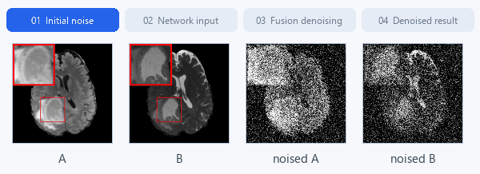
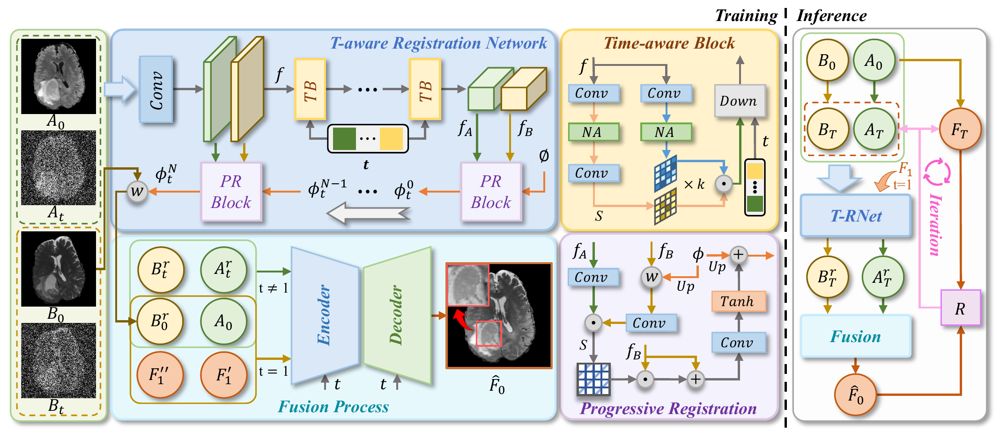
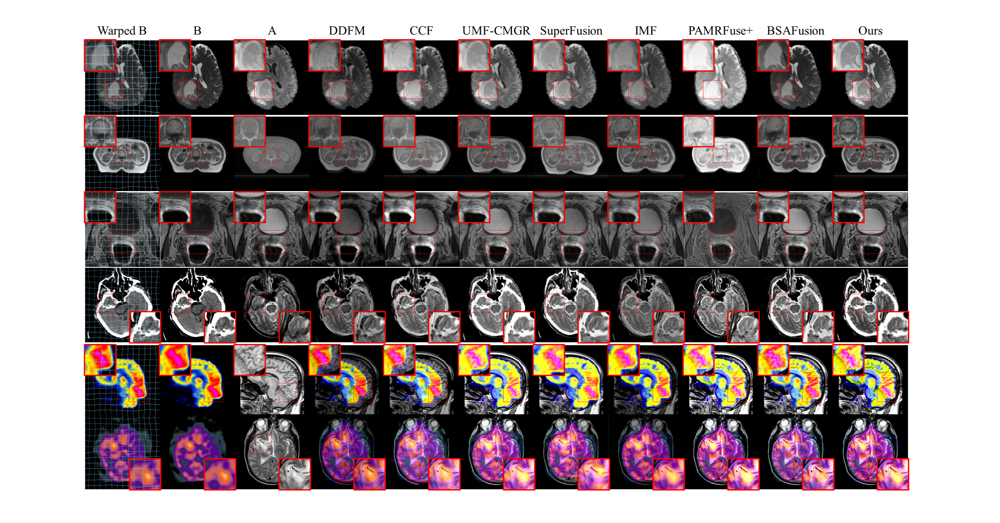
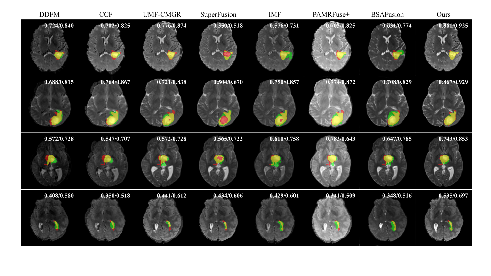
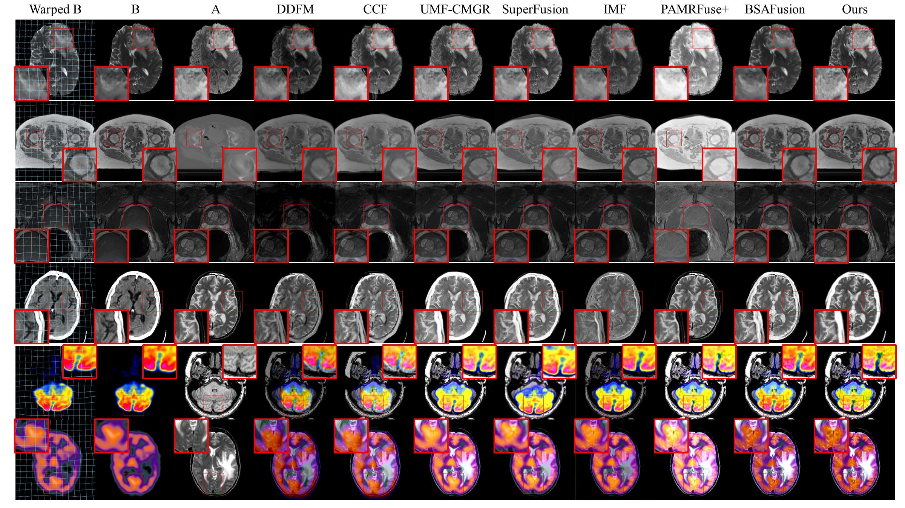

# ResFusion

<p align="center">
  
</p>

<p align="center">
  💻 <a href="https://github.com/medcx/ResFusion">GitHub</a> &nbsp; | &nbsp;
  📦 <a href="https://drive.google.com/file/d/1i_Qt28X4c7QUhAvQKeSkB8eOJGSOIiGa/view?usp=sharing">checkpoint</a> &nbsp; | &nbsp;
  🔬 <a href="#method">Method</a> &nbsp; | &nbsp;
  🚀 <a href="#quick-start">Quick Start</a> &nbsp; | &nbsp;
  📊 <a href="#results">Results</a> &nbsp; | &nbsp;
  📖 <a href="#citation">Citation</a>
</p>

---

**Medical Image Fusion Driven by Implicit-Forward Diffusion and Time-aware Joint Optimization (NeurIPS 2026)**

This repository contains the official implementation of **ResFusion: Medical Image Fusion Driven by Implicit-Forward Diffusion and Time-aware Joint Optimization**, presented at **NeurIPS 2026**.

ResFusion brings registration and medical image fusion into a joint framework, combining **implicit-forward diffusion**, **time-aware registration**, and **progressive alignment**.

<p align="center">
  
</p>

## Method

<p align="center">
  <a href="assets/method.png"></a>
</p>

<p align="center"><em>Overview of ResFusion. Time-aware blocks and progressive registration align the input modalities within the iterative fusion process.</em></p>

## Quick Start

Run all commands from the repository root.

### 1. Prepare the checkpoint

Download the [ResFusion_BraTs](https://drive.google.com/file/d/1i_Qt28X4c7QUhAvQKeSkB8eOJGSOIiGa/view?usp=sharing), rename it to **`model_best.pth`**, and place it as follows:

```text
ResFusion/
├── configs/
│   ├── demo.yaml
│   └── fusion_brats.yaml
├── MyDatasets/
│   └── Demo/
├── demo_results/
│   └── model_best.pth
└── test_demo.py
```

### 2. Run the demo

The demo loads data from `MyDatasets/Demo`, as configured in `configs/demo.yaml`.

```bash
python test_demo.py
```

### 3. Dataset Preparation and Training

Download the datasets from their official sources:

- [BraTS 2023](https://www.synapse.org/Synapse:syn51156910)
- [SynthRAD2023 (Pelvis)](https://zenodo.org/records/7260705)
- [TCIA Prostate](https://www.cancerimagingarchive.net/collection/prostate-fused-mri-pathology/)
- [Harvard Whole Brain Atlas](https://www.med.harvard.edu/aanlib/)

#### Example: Train on BraTS

Set `data_dir` and `output_dir` in `brats_preprocess.py` to your local paths. For T2-weighted and T2-FLAIR fusion, set `selected_modalities = ["t2w", "t2f"]`, then run:

```bash
python brats_preprocess.py
```

Update `data.train.params.dataset_path` and `data.val.params.dataset_path` in `configs/fusion_brats.yaml` to point to the corresponding preprocessed dataset splits. Start training with:

```bash
python main.py --cfg_path configs/fusion_brats.yaml --save_dir results/brats
```

For details of the dataset preprocessing pipelines, see [brats_preprocess.py](https://github.com/medcx/ResFusion/blob/main/brats_preprocess.py) and [pelvis_preprocess.py](https://github.com/medcx/ResFusion/blob/main/pelvis_preprocess.py).

## Results

### Fusion comparison

<p align="center">
  <a href="assets/fusion_comparison.png"></a>
</p>

<p align="center"><em>Qualitative comparison with DDFM, CCF, UMF-CMGR, SuperFusion, IMF, PAMRFuse+, and BSAFusion. Red boxes highlight local details; ResFusion is shown in the rightmost column.</em></p>

### Downstream segmentation

<p align="center">
  <a href="assets/segmentation_comparison.png"></a>
</p>

<p align="center"><em>Segmentation visualizations on fused images. Colored overlays and score annotations are reproduced from the original figure.</em></p>

<details>
<summary><strong>More fusion examples</strong></summary>

<p align="center">
  <a href="assets/fusion_additional.png"></a>
</p>

Additional examples using the same comparison methods. Red boxes indicate the regions enlarged for visual inspection.

</details>

*Click a figure to view it at full resolution.*

## Citation

If you find ResFusion useful in your research, please cite [**Medical Image Fusion Driven by Implicit-Forward Diffusion and Time-aware Joint Optimization (NeurIPS 2026)**](https://openreview.net/forum?id=W44dmCYl89).

```
@inproceedings{
xu2026resfusion,
title={ResFusion: Medical Image Fusion Driven by Implicit-Forward Diffusion and Time-aware Joint Optimization},
author={Jiahua Xu and Dawei Zhou and Zhengkun Yu and Lei Hu and Lecong Xiong and Zaiyi Liu and Nannan Wang and Xinbo Gao},
booktitle={The Fortieth Annual Conference on Neural Information Processing Systems},
year={2026},
url={https://openreview.net/forum?id=W44dmCYl89}
}
```

## Acknowledgments

Thank you for your interest in ResFusion. A star on [GitHub](https://github.com/medcx/ResFusion) is appreciated!
